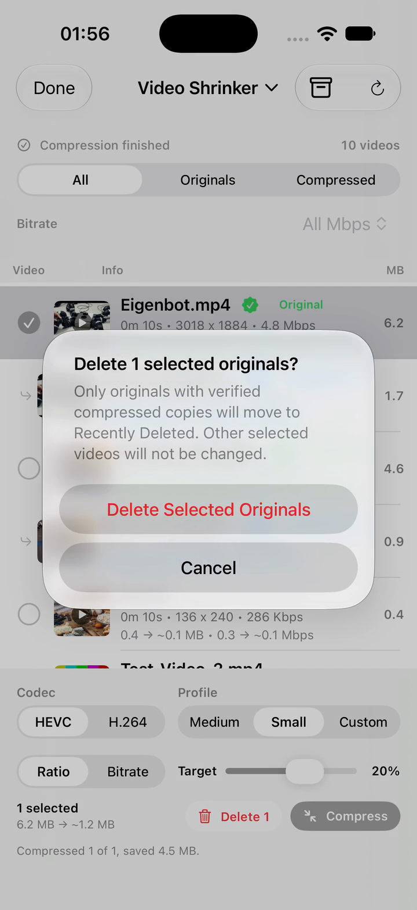

# Library Shrinker

Library Shrinker is an iOS utility for finding large videos and screenshots, creating smaller copies, and safely reviewing the result before removing an original.

## Full Simulator Demo

https://github.com/user-attachments/assets/e003c406-0a9b-41bc-b8c1-841053346a79

**[Watch the full simulator demo](Docs/Library-Shrinker-Demo.mp4)**

**[Watch the complete uncut recording](Docs/Library-Shrinker-Demo-Full.mp4)**

## Highlights

- Scan videos and screenshots from the photo library.
- Select one or multiple items for compression or deletion.
- Choose HEVC or H.264 and control the target size by ratio or bitrate.
- Continue an active compression task after leaving the app.
- Automatically show the compressed copy and its verified original relationship.
- Preview results before using guarded deletion actions.
- Export and import scan metadata, compression relationships, and deletion records.

## Demo flow

The demo selects a 6.2 MB test video, compresses it to 1.7 MB with HEVC at a 20% target, briefly leaves the app to demonstrate background continuation, previews the generated copy, cancels a deletion confirmation, and opens Backup & Restore.

The footage was recorded on an iPhone simulator using synthetic test media. No personal photo-library content is included. Long processing time is accelerated in the edited demo. A compressed version of the complete recording is also included; the 85 MB source capture remains local and is excluded from Git.

## Verification

The exercised simulator scenarios and expected results are documented in [Simulator Test Cases](Docs/Simulator-Test-Cases.md).
